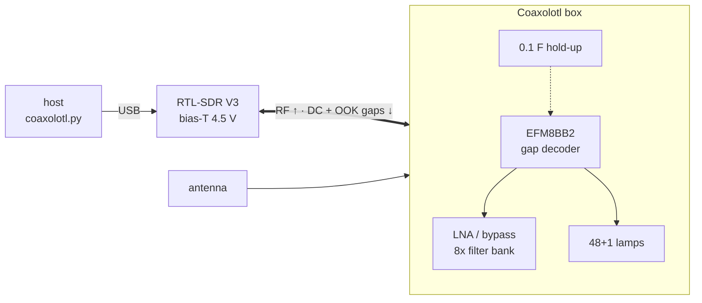

# Coaxolotl

**A mast-head LNA and 8-way filter bank that lives entirely on one coax.**
An RTL-SDR's bias-T powers it, and the same bias-T switches it by blinking
its power in short gaps. Its front panel shows every internal state on a
lamp, like a 1970s minicomputer.

```
  BANK   ○THRU ○LF ○160/80 ○60-30 ○20-10 ○6/4m ●2m/AIR ○70/23cm
  FRAME  S:●○●  P:●●○●○○  C:○○●○●●
  DECODE ○RX ○0 ○1 ●OK ○ERR  | ○SYNC ○CHK ○GAP ○RUNT ○TMO
  RF     ●LNA ○BYP ○AUTO ●FMN  | ○I-LO ●I-OK ○I-HI ○TRIP
  SYSTEM ○RUN ●HOLD ○LOW ○QUIET  | ○DROP ○GLT ○RST
```

## How it works



* **Link.** Bias off for 30 ms is a 0 and for 70 ms is a 1, with 100 ms of
  power between bits. A frame is `sync 101 | bank·LNA·quiet·clr | inverse`
  and takes about 2.5 s. The sync bits calibrate the threshold, so clock
  skew, slow discharge and USB jitter cancel out.
  → [docs/protocol.md](docs/protocol.md)
* **RF path.** Antenna → protection → LNA (with preselector, optional FM
  notch) or bypass → PE42582 SP8T → 8 filters → PE42582 → bias-T → coax.
  The HF/LF branches force bypass automatically.
  → [bandplan.json](bandplan.json)
* **Power.**
  * An ideal diode keeps the sense node fast.
  * A 330 µF stage boots the MCU in about 30 ms, and a 0.1 F supercap rides
    through dropouts for minutes.
  * The LNA sits behind a current-limited switch with a shunt monitor.
  → [docs/hardware.md](docs/hardware.md)
* **Quiet when idle.** The EFM8BB2 Snoozes with its high-frequency clock
  stopped. It wakes only on a bias edge, an LNA fault or every 6.5 s for
  housekeeping. The lamps are statically latched, so there is no
  multiplexing noise either. The RUN lamp tells you when the MCU clock is
  running.
* **Panel.** 48 lamps on 6×74HC595 plus a hard-wired PWR lamp. It shows bank,
  received bits, decoder errors, LNA path and current, trip, hold-up, rail
  voltage and sticky dropout/glitch/reset flags. Software modes: full, bands
  only, or off (PWR lamp only), kept in flash. → [docs/panel.md](docs/panel.md)

## Quick start

```bash
# host tests + simulator (gcc, python3)
make -C firmware test sim
python3 -m unittest discover -s host

# what the box would do, without hardware
python3 host/coaxolotl.py send --band 2m --lna --backend dry-run \
  | firmware/build/sim --fall-delay 6 --jitter 2

# firmware (SDCC >= 4.2)
make -C firmware            # Snooze build
make -C firmware SNOOZE=0   # bring-up build, classic registers only

# real link
python3 host/coaxolotl.py bands
python3 host/coaxolotl.py send --band 2m --lna                 # pyrtlsdr
python3 host/coaxolotl.py send --bank 3 --backend rtl_biast    # rtl-sdr-blog tool
python3 host/coaxolotl.py panel bands                          # lamps: full | bands | off
```

## Repository

| Path | What |
|---|---|
| `bandplan.json` | the 8 branches, single source of truth (firmware header is generated) |
| `firmware/src/decoder.*` | gap-width OOK decoder, pure C |
| `firmware/src/app.*` | RF routing, health, sticky flags, animations, pure C |
| `firmware/src/panel.*` | state → 48-bit lamp image |
| `firmware/src/hal_efm8bb2.c`, `main.c` | EFM8BB2 hardware layer and main loop |
| `firmware/include/efm8bb2_sfr.h` | minimal SDCC SFR map |
| `firmware/test/` | unit tests and `sim` (edge replay + ASCII panel) |
| `host/coaxolotl.py` | keyer: pyrtlsdr / rtl_biast / dry-run, plus library API |
| `hardware/bom.csv` | first-pass BOM |
| `docs/` | protocol, hardware, panel, bring-up |

## Status (v0.1)

* ✅ Decoder, app logic and panel pass 179 host checks. That includes all 64
  payloads, 1800 randomised frames at ±10 % clock skew, 0–10 ms fall delay
  and ±3 ms jitter, every error path and the LED power budget.
* ✅ Host encoder → firmware decoder, end to end, through the simulator.
* ✅ The firmware builds with SDCC 4.2 for EFM8BB21F16G (about 13.5 kB of 15 kB
  flash; the page below the lock byte holds the panel-mode log) in both the Snooze and the bring-up build.
* ⚠️ The firmware has **not run on silicon yet**. Three EFM8BB2 register
  details (Snooze bit, Timer 4 LFOSC clock select, Snooze wake on a Timer 4
  wrap) and the ADC setup are marked VERIFY. `docs/bringup.md` has a test
  for each, and the `SNOOZE=0` build avoids them.
* ⚠️ No schematic or PCB yet. The open items before layout are listed in
  `docs/hardware.md`.

## License

| Part | License |
|---|---|
| Hardware: `hardware/` (schematics, PCB, BOM), and the hardware design in `docs/hardware.md` | [CERN-OHL-S-2.0](hardware/LICENSE) |
| Software: `firmware/`, `host/`, `tools/`, future SDR plugins | [MIT](LICENSE) |

Documentation follows the part it describes.
