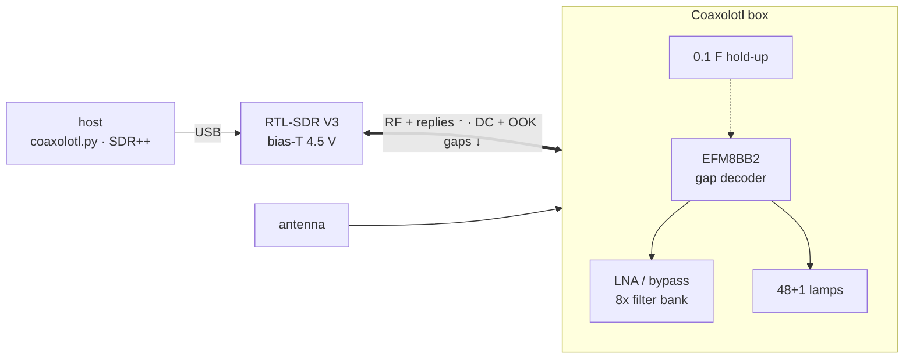

# Coaxolotl

**A mast-head LNA and 8-way filter bank that lives entirely on one coax.**
An RTL-SDR's bias-T powers it, and the same bias-T switches it by blinking
its power in short gaps. It answers on the same coax with a keyed clock the
dongle receives, so the host sees what it did and what it measures. Its
front panel shows every internal state on a lamp, like a 1970s
minicomputer.

```
  BANK   ○THRU ○LF ○160/80 ○60-30 ○20-10 ○6/4m ●2m/AIR ○70/23cm
  FRAME  S:●○●  P:●●○●○○  C:○○●○●●
  DECODE ○RX ○0 ○1 ●OK ○ERR  | ○SYNC ○CHK ○GAP ○RUNT ○TMO
  RF     ●LNA ○BYP ○AUTO ●FMN  | ○I-LO ●I-OK ○I-HI ○TRIP
  SYSTEM ○RUN ●HOLD ○LOW ○QUIET  | ○DROP ○GLT ○RST
```

## How it works



* **Link.** Bias off for 30 ms is a 0 and for 70 ms is a 1, with 100 ms of
  power between bits. A frame is `sync 101 | bank·LNA·quiet·clr | inverse`
  and takes about 2.5 s. The sync bits calibrate the threshold, so clock
  skew, slow discharge and USB jitter cancel out.
  → [docs/protocol.md](docs/protocol.md)
* **Back-channel.** After every frame (and once after boot) the MCU keys a
  12.25 MHz clock onto the coax for 0.8 s. The dongle hears its 3rd
  harmonic at 36.75 MHz. The 8-byte Manchester packet carries ACK/NAK with
  the error, the switch state actually set, VCOAX, the whole coax current
  (the bias-T budget, BUDGET flag at 170 mA), LNA current, supercap voltage
  and the sticky flags. Readings are calibrated against a meter over the same
  link. The host searches the band for it, so the ±2 % RC oscillator needs no
  trimming.
  → [docs/protocol.md](docs/protocol.md#back-channel-box--host)
* **SDR++.** `sdrpp/coaxolotl_source` is an RTL-SDR source for SDR++ with
  the link built in: branch, LNA, Send/Poll/Clear, follow-tuning and a
  telemetry readout. → [sdrpp/README.md](sdrpp/README.md)
* **RF path.** Antenna → protection → LNA (with preselector, optional FM
  notch) or bypass → PE42582 SP8T → 8 filters → PE42582 → bias-T → coax.
  The HF/LF branches force bypass automatically.
  → [bandplan.json](bandplan.json)
* **Power.**
  * An ideal diode keeps the sense node fast.
  * A 330 µF stage boots the MCU in about 30 ms, and a 0.1 F supercap rides
    through dropouts for minutes.
  * The LNA sits behind a current-limited switch with a shunt monitor.
  → [docs/hardware.md](docs/hardware.md)
* **Quiet when idle.** The EFM8BB2 Snoozes with its high-frequency clock
  stopped. It wakes only on a bias edge, an LNA fault or every 6.5 s for
  housekeeping. The lamps are statically latched, so there is no
  multiplexing noise either. The RUN lamp tells you when the MCU clock is
  running.
* **Panel.** 48 lamps on 6×74HC595 plus a hard-wired PWR lamp. It shows bank,
  received bits, decoder errors, LNA path and current, trip, hold-up, rail
  voltage and sticky dropout/glitch/reset flags. Software modes: full, bands
  only, or off (PWR lamp only), kept in flash. → [docs/panel.md](docs/panel.md)

## Quick start

```bash
# host tests + simulator (gcc, g++, python3 + numpy)
make -C firmware test sim
make -C sdrpp test
python3 -m unittest discover -s host

# what the box would do, without hardware
python3 host/coaxolotl.py send --band 2m --lna --backend dry-run \
  | firmware/build/sim --fall-delay 6 --jitter 2

# firmware (SDCC >= 4.2)
make -C firmware            # EFM8BB52 (control board), Snooze build
make -C firmware SNOOZE=0   # bring-up build, classic registers only
make -C firmware MCU=bb21   # EFM8BB21 QFN20: the 4-layer RF board

# real link
python3 host/coaxolotl.py bands
python3 host/coaxolotl.py send --band 2m --lna                 # pyrtlsdr
python3 host/coaxolotl.py send --bank 3 --backend rtl_biast    # rtl-sdr-blog tool
python3 host/coaxolotl.py panel bands                          # lamps: full | bands | off
python3 host/coaxolotl.py send --band 2m --lna --listen        # ... and read the reply
python3 host/coaxolotl_gui.py                                  # control panel (--sim: no hardware)
```

## Pin map

### EFM8BB52F32I-C-QFN32: control board (`make -C firmware`, the default)

Source of truth: `firmware/src/hal_efm8bb52.c`; checked against the
`hardware/kicad_ctrl` netlist.

| Pin | Port | Net | Dir | Function |
|---|---|---|---|---|
| 1 | P0.0 | VREF | ana | precision reference 2.4 V, C50 100 nF; on only while measuring |
| 32 | P0.1 | FAULT_N | in | TPS2553 FAULT, 100 k pull-up; port-match wake |
| 31 | P0.2 | SENSE | in + ana | VCOAX divider 10k/22k: port-match wake on both edges and ADC0.0 at once (PRTDRV.COEX); C2 10 nF |
| 30 | P0.3 | SCAP_ADC | ana | supercap / 2 (1 M / 1 M, C11), ADC0.1 |
| 29 | P0.4 | TP_TX | out | UART0 TX test point (factory bootloader, debug) |
| 28 | P0.5 | TP_RX | in | UART0 RX test point |
| 27 | P0.6 | LNA_EN | out | TPS2553 EN; 10 k pull-down |
| 26 | P0.7 | LNA_PATH | out | input SPDT U6, 1 = LNA; 10 k pull-down = bypass |
| 25, 24, 23 | P1.0–P1.2 | SW_V1..V3 | out | both PE42582 (via J6); 10 k pull-downs = F0 THRU |
| 22 | P1.3 | LNA_PATH_OUT | out | output SPDT U7, same polarity; 10 k pull-down |
| 21 | P1.4 | FMN | out | FM notch SPDTs; 10 k pull-down |
| 20, 19 | P1.5, P1.6 | — | out | spare, driven low |
| 18 | P1.7 | BEACON | out | PCA CEX0 12.25 MHz during a reply → R31/R32/R33/C47 → coax; low otherwise |
| 17 | P2.0 | LED_SER | out | 74HC595 chain data (U14 first) |
| 16 | P2.1 | LED_SCK | out | shift clock |
| 15 | P2.2 | LED_RCK | out | latch clock |
| 14 | P2.3 | LED_OE_N | out | output enable; 10 k pull-up = lamps dark in reset |
| 13 | P2.4 | ILNA_ADC | ana | LNA current: R7 0.39 Ω, U3 INA180A2, 19.5 mV/mA, R8/C7; ADC0.13 |
| 12 | P2.5 | ITOT_ADC | ana | whole coax current: R35 0.1 Ω, U20 INA180A3, 10 mV/mA, R36/C48; ADC0.14 |
| 11 | P2.6 | — | out | spare, driven low |
| 10–6 | P3.0–P3.4 | — | out | spare, driven low |
| 5 | P3.7 / C2D | C2D | | debug; R34 10 k pull-up (low at reset = factory bootloader) |
| 4 | RSTb / C2CK | RST_N | | R13 10 k pull-up, C2 clock |
| 3 | VDD | +3V3 | | C15 100 nF + C14 1 µF |
| 2 | N/C | | | |
| EP | GND | | | the only ground pin |

J6 (via row to a later RF board): 1 +3V3, 2 LNA_VCC, 3–5 SW_V1..V3,
6 LNA_PATH, 7 LNA_PATH_OUT, 8 FMN, 9–10 GND.

### EFM8BB21F16G-C-QFN20: 4-layer RF board (`make -C firmware MCU=bb21`)

Source of truth: `firmware/src/hal_efm8bb2.c`. All 16 port pins are used.

| Pin | Port | Net | Dir | Function |
|---|---|---|---|---|
| 2 | P0.0 | SENSE | in | VCOAX divider; port-match wake |
| 1 | P0.1 | VC_ADC | ana | same divider node |
| 20 | P0.2 | SCAP_ADC | ana | supercap / 2 |
| 19 | P0.3 | ILNA_ADC | ana | INA180A2 output |
| 18 | P0.4 | LED_OE_N | out | lamp output enable; 10 k pull-up |
| 17 | P0.5 | FAULT_N | in | TPS2553 FAULT; port-match wake |
| 16 | P0.6 | LNA_EN | out | 10 k pull-down |
| 15 | P0.7 | LNA_PATH | out | input SPDT U6; 10 k pull-down |
| 14, 13, 11 | P1.0–P1.2 | SW_V1..V3 | out | both PE42582; 10 k pull-downs |
| 10 | P1.3 | LNA_PATH_OUT | out | output SPDT U7; 10 k pull-down |
| 9 | P1.4 | LED_SER (+ BEACON) | out | 595 data; PCA CEX0 during a reply (no tap on this board yet) |
| 8 | P1.5 | LED_SCK | out | |
| 7 | P1.6 | LED_RCK | out | |
| 6 | P2.0 / C2D | FMN | out | through R30 1 k; 10 k pull-down |
| 5 | RSTb / C2CK | RST_N | | 10 k pull-up |
| 4 | VDD | +3V3 | | |
| 3, 12, EP | GND | | | |

No whole-coax current monitor on this board: I_TOT reads 0.

## Repository

| Path | What |
|---|---|
| `bandplan.json` | the 8 branches, single source of truth (firmware header is generated) |
| `firmware/src/decoder.*` | gap-width OOK decoder, pure C |
| `firmware/src/app.*` | RF routing, health, sticky flags, animations, pure C |
| `firmware/src/panel.*` | state → 48-bit lamp image |
| `firmware/src/beacon.*` | reply packet, CRC and chip sequence, pure C |
| `firmware/src/hal_efm8bb2.c`, `main.c` | EFM8BB21 (QFN20) hardware layer and main loop |
| `firmware/src/hal_efm8bb52.c` | EFM8BB52F32 (QFN32) hardware layer, the default build |
| `firmware/include/efm8bb*_sfr.h` | minimal SDCC SFR maps (BB2, BB52) |
| `firmware/test/` | unit tests and `sim` (edge replay + ASCII panel) |
| `host/coaxolotl.py` | keyer: pyrtlsdr / rtl_biast / dry-run, `--listen`, `listen`, `decode` |
| `host/backchannel.py` | reply packet and demodulator (numpy) |
| `host/link.py` | one open RTL-SDR (or the firmware simulator): key a frame, read the reply |
| `host/coaxolotl_gui.py` | control panel for the PC (tkinter), see `docs/host.md` |
| `sdrpp/` | SDR++ source module and its standalone tests |
| `hardware/kicad/` | 4-layer RF board: generated schematic (`tools/build.py`), layout, JLC package in `jlc/` |
| `hardware/kicad_ctrl/` | 2-layer control board without RF (`COAX_VARIANT=ctrl`), JLC package in `jlc/` |
| `hardware/bom.csv` | grouped BOM of the RF board schematic (`tools/bom.py`) |
| `docs/` | protocol, hardware, panel, bring-up, PC software (`host.md`) |

## Status (v0.1)

* ✅ Decoder, app logic and panel pass 194 host checks. That includes all 64
  payloads, 1800 randomised frames at ±10 % clock skew, 0–10 ms fall delay
  and ±3 ms jitter, every error path and the LED power budget.
* ✅ Host encoder → firmware decoder, end to end, through the simulator.
* ✅ The firmware builds with SDCC 4.2, back-channel included, in both the
  Snooze and the bring-up build: EFM8BB52F32 about 15.4 of 28 kB, EFM8BB21F16G
  about 15.2 of 15.4 kB (full: new features go to the BB52 only). One flash
  page holds the settings log (panel mode, calibration).
* ✅ PC control panel (`host/coaxolotl_gui.py`) and link layer (`host/link.py`),
  tested end to end against the firmware simulator.
* ✅ Back-channel: firmware checks for HELLO/ACK/NAK, timing, contents and
  the chip round-trip. Firmware packets go through the simulator into the
  Python and C++ demodulators, which decode synthetic captures with the
  carrier anywhere in ±0.75 MHz and chips ±10 %.
* ⚠️ The SDR++ module compiles against the SDR++ headers but has not run in
  SDR++ yet. The beacon level (about −65 dBm) is calculated, not measured.
* ⚠️ The firmware has **not run on silicon yet**. Three EFM8BB2 register
  details (Snooze bit, Timer 4 LFOSC clock select, Snooze wake on a Timer 4
  wrap), the ADC setup and the PCA/CLKSEL/crossbar setup of the beacon are
  marked VERIFY. `docs/bringup.md` has a test
  for each, and the `SNOOZE=0` build avoids them.
* ✅ Schematic and two routed layouts with JLC packages: the 4-layer RF board
  (`hardware/kicad`) and the 2-layer control board without RF
  (`hardware/kicad_ctrl`). Open items are listed in `docs/hardware.md`.

## License

| Part | License |
|---|---|
| Hardware: `hardware/` (schematics, PCB, BOM), and the hardware design in `docs/hardware.md` | [CERN-OHL-S-2.0](hardware/LICENSE) |
| Software: `firmware/`, `host/`, `tools/`, future SDR plugins | [MIT](LICENSE) |

Documentation follows the part it describes.
