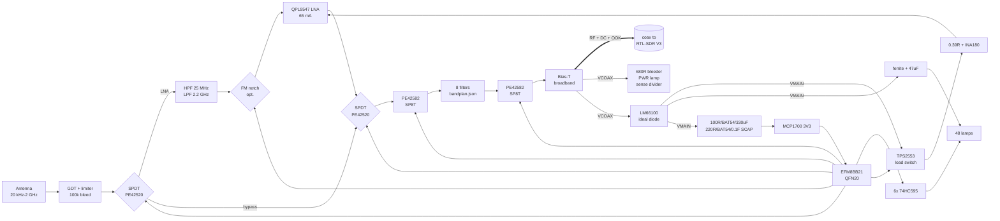

# Hardware

> Status: architecture and values of the first boards. Nothing here has been
> built yet. Lines marked **VERIFY** need a datasheet check or a bench
> measurement.
>
> Two layouts exist. The 4-layer board (`hardware/kicad`, branch
> `feat/pcb-layout`) carries the whole RF path below. The 2-layer control
> board (`hardware/kicad_ctrl`, branch `feat/control-2l`) has no RF parts: it
> keeps the bias-T, power, MCU and lamps, and hands the switch controls to a
> later RF board through J6 (see [Control board](#control-board-2-layers-no-rf)).

## Block diagram



## Power tree

```
coax centre ──► broadband choke ──► VCOAX ─┬─ 680 Ω bleeder ── GND           (6.3 mA, sets fall time)
                                           ├─ 3.3 kΩ + PWR LED ── GND        (0.7 mA)
                                           ├─ 10 k / 22 k ── SENSE, VC_ADC   (to MCU, 3.0 V @ 4.4 V)
                                           └─ LM66100 ──► VMAIN ─┬─ TPS2553 (EN, ILIM, FAULT) ─ 0.39 Ω ─ LNA
                                                                 ├─ ferrite ─ 47 µF ─ LED anodes
                                                                 ├─ 100 Ω ─ BAT54 ─┐
                                                                 └─ 220 Ω ─ BAT54 ─ SCAP 0.1 F ─ BAT54 ─┤
                                                                                         VHOLD (330 µF) ┴─ MCP1700-3.3 ─ 3V3
```

Why it is split like this:

* **SENSE sits ahead of every bulk capacitor.** Only the bleeder, the PWR
  lamp and about 100 nF hang on VCOAX, so the falling edge depends on the
  coax and on the capacitance on the RTL-SDR side, not on the LNA or LED
  state. Earlier drafts let the LNA pull the rail down. A tripped LNA would
  then have slowed every falling edge to over 100 ms and broken the link.
* **The ideal diode** (LM66100, about 80 mΩ) stops VMAIN, the lamps and the
  hold-up from back-feeding VCOAX during a gap. Its CE pin must be tied to
  VOUT, not GND. Only then does its comparator block reverse current. With CE
  on GND it would just be an always-on switch. ST is unused and goes to GND.
* **Two hold-up stages are diode-OR'ed.**
  * The 330 µF stage charges in about 30 ms, so the MCU boots fast.
  * The 0.1 F supercap charges slowly (τ ≈ 22 s, ≤ 18 mA). It carries the
    3V3 domain (about 0.6 mA) through a dropout for roughly 4 minutes, and
    the switches keep their state.
  * The HOLD lamp shows the supercap state.
* **The lamps hang on VMAIN, not on the hold-up.** They go dark during gaps
  and dropouts instead of draining the supercap.

### Fall-time budget (VERIFY on the bench)

The decoder accepts up to about 10 ms of delay between the host switching
the bias off and SENSE going low. With only the bleeder, the PWR lamp and
the divider as load, the delay is about 1.1 × R_eff × C_total:

* R_eff is the bleeder in parallel with the PWR lamp and the divider: about
  560 Ω with the 680 Ω bleeder.
* C_total is the bias-T output capacitance on the RTL side, plus the coax
  (about 100 pF/m), plus the 100 nF here.

| C on RTL side | 680 Ω bleeder | 470 Ω bleeder |
|---|---|---|
| 1 µF | 0.6 ms | 0.45 ms |
| 10 µF | 6.2 ms | 4.5 ms |
| 22 µF | 13.5 ms ✗ | 9.9 ms |

Measure it as described in bring-up step 1, and lower the bleeder if you
need to. Every 100 Ω costs about 0.6 mA more.

## Power budget (RTL-SDR V3 bias-T: 4.5 V, about 180 mA)

| Load | Rail | Steady | Peak |
|---|---|---|---|
| LNA (QPL9547, 65 mA default; budget kept at 100 mA) | VMAIN | 65–100 mA | — |
| Lamps (1 mA each) | VMAIN | 8–15 mA typical, 23 mA worst | 48 mA during the lamp test (LNA still off) |
| Bleeder + PWR + divider | VCOAX | 7 mA | |
| 3V3 domain: MCU, INA180, PE42582 ×2, PE42520 ×2 (+2 DNP), 595s | VHOLD | 0.6 mA (Snooze) – 1.5 mA (active) | |
| Hold-up charging | VMAIN | 0 | 40 mA (330 µF, about 0.1 s) + 18 mA (SCAP, decays over about 1 min) |
| **Total** | | **about 120 mA typical, 132 mA worst** | **about 140 mA** right after boot while the SCAP is still charging |

The cable drop is about 50 mΩ/m loop for RG58. At 30 m and 140 mA that is
about 0.2 V, so VCOAX ≈ 4.2–4.3 V. The LOW lamp lights below 3.9 V.
**VERIFY** that the QPL9547 still meets its gain and OIP3 at about 4.2 V
(it is specified for 3.3–5 V).

## MCU: EFM8BB21F16G-C-QFN20

The EFM8BB2 replaces the BB1 in the original sketch. The BB2 has a
**Snooze** mode (about 26 µA) with the high-frequency oscillator stopped. It
wakes on a port-match edge or a Timer 4 event, and Timer 4 runs from the
80 kHz LFOSC. While the box sits on a band, no MCU clock runs at all, so
there are no MCU spurs in the receiver. The BB1 can only Idle with a running
clock (Stop exits only through reset).

The QSOP24 package is end of life (Silicon Labs PCN 2402211513, last order
2024-08-27); its successor is the QFN20 (3 × 3 mm, 16 port pins). All 16 are
used: the old TP_TX test point is gone and FMN shares P2.0 with the C2 debug
data line through R30 (1 kΩ), so the debugger can override it.

| Pin | Port | Net | Dir | Note |
|---|---|---|---|---|
| 2 | P0.0 | SENSE | in | VCOAX divider; port-match wake on both edges |
| 1 | P0.1 | VC_ADC | ana | same divider node |
| 20 | P0.2 | SCAP_ADC | ana | 1 M / 1 M + 100 nF |
| 19 | P0.3 | ILNA_ADC | ana | INA180A2 out (19.5 mV/mA) |
| 18 | P0.4 | LED_OE_N | out | 10 k pull-up: lamps dark until the first write |
| 17 | P0.5 | FAULT_N | in | TPS2553 FAULT, 100 k pull-up to 3V3, port-match wake |
| 16 | P0.6 | LNA_EN | out | 10 k pull-down: LNA off during reset |
| 15 | P0.7 | LNA_PATH | out | input SPDT U6; 1 = through LNA; 10 k pull-down = bypass. hal_rf() switches it together with LNA_PATH_OUT (P1.3) |
| 14, 13, 11 | P1.0–P1.2 | SW_V1..V3 | out | both PE42582 in parallel; 10 k pull-downs = branch 0 (THRU) |
| 10 | P1.3 | LNA_PATH_OUT | out | output SPDT U7 (its own line, same polarity as LNA_PATH); 10 k pull-down = bypass |
| 9 | P1.4 | LED_SER | out | 595 chain data |
| 8 | P1.5 | LED_SCK | out | |
| 7 | P1.6 | LED_RCK | out | |
| 6 | P2.0 / C2D | FMN | out | FM-notch SPDTs (DNP option); through R30 1 k; 10 k pull-down |
| 5 | RSTb / C2CK | RST_N | | 10 k pull-up, C2 clock |
| 3, 12, EP | GND | | | |
| 4 | VDD | +3V3 | | |

During reset and boot the pull-downs give a safe state: THRU, bypass, LNA
unpowered, lamps off. The box then behaves like a plain cable until the
firmware runs.

## RF notes

* **Switches.**
  * 2× PE42582 SP8T (9 kHz–8 GHz, absorptive, QFN-24 4×4 mm). LS (pin 1,
    internal 1 MΩ pull-up) is tied to GND, and so is V4 (V4 = 1 would turn
    all ports off). With LS = 0 the V3 V2 V1 code per RF port is
    RF1 000, RF2 100, RF3 010, RF4 110, RF5 001, RF6 101, RF7 011, RF8 111,
    so it is not binary.
  * Branch Fk is wired to RF(k+1) on both switches. `port` in
    `bandplan.json` is that RF port index (0 = RF1), and
    `tools/gen_bandplan.py` turns it into the switch code. Routing order and
    the truth table live in data, not in code.
  * VSS_EXT goes to GND, which selects the internal negative-voltage
    generator. If its spur shows up on the waterfall, feed −3.3 V on VSS_EXT
    (bypass mode).
  * RF ports sit at 0 V DC, so no DC blocks are needed around the switches.
* **LNA bypass.** 2× PE42520 SPDT (9 kHz–13 GHz, 2.3–5.5 V, QFN-16
  3×3 mm, C500478). CTRL = 0 selects bypass, CTRL = 1 the LNA branch, on
  both switches. U6 (input, LNA_PATH) has LS = VDD: CTRL = 0 → RF1. U7
  (output, LNA_PATH_OUT) has LS = GND (CTRL = 0 → RF2), so its RF ports swap
  and the board needs no crossing; the schematic draws it as `PE42520R`.
* **LNA: Qorvo QPL9547** (0.1–6 GHz, NF 0.3 dB and OIP3 about +39 dBm at
  1.9 GHz, 3.3–5 V, DFN-8 2×2 mm). The stage copies one stage of the SWL434
  (Spacewalker LNA, 434 MHz):
  * VBIAS through 3.32 kΩ (R25) from LNA_VCC, with 100 pF at the VCC end;
  * VDD into RF_OUT through 560 nH (L4), 100 pF to GND, then a ferrite bead
    (FB2) and another 100 pF;
  * SHDN and the NC pins 4, 5 and 8 go to GND, pin 3 stays open.
  * The DC blocks are 1 nF C0G instead of the SWL434's 100 pF, because the
    branch has to work from 25 MHz (100 pF is 64 Ω there).
  * **VERIFY** the 25–100 MHz gain and match: the part is specified from
    100 MHz, and 560 nH is only about 90 Ω at 25 MHz.
* **The preselector sits only in the LNA branch.** It is an HPF at 25 MHz
  (5–7th order LC) plus an LTCC LPF at about 2.2 GHz, so the HF/LF branches
  stay untouched. Branches F1–F4 force bypass and light **AUTO**. Below
  30 MHz the external noise is far above the RTL noise figure, and an LNA
  there only adds IMD.
* **The FM notch is a population option.** It is a PE42520 pair (U9, U10) around an
  88–108 MHz LC notch (56 nH ‖ 47 pF, f0 ≈ 98 MHz) inside the LNA branch, and it is used only by branches
  with `fm_notch` (F6 by default). Fit 0 Ω links first and populate it only
  if you measure FM-driven IMD.
* **Bias-T in the box.** It must pass DC and 20 kHz–2 GHz. A starting point:
  * series choke chain 1 mH (≥ 200 mA) → 10 µH → 100 nH, with 220 Ω across
    the 10 µH to damp resonances
  * DC block 2.2 µF ‖ 1 nF ‖ 22 pF
  * **VERIFY** S21 with a VNA.
  * The RTL-SDR V3's own bias-T choke and its ~500 kHz direct-sampling floor
    limit the LF branch anyway, so F1 is mostly a demo with a V3.
* **Protection.** At the antenna: 90 V GDT, a low-C limiter diode pair, and
  100 kΩ to ground. Use a resistor here, not a choke: 1 mH would shunt 20 kHz.
  On VCOAX: a 5 V TVS. **VERIFY** that its clamp voltage stays below the
  LM66100 / TPS2553 absolute maximum ratings. If not, add 1 Ω plus a 5.6 V
  zener.

## Lamp driver

* 6× 74HC595 (TSSOP-16) powered from 3V3, with the outputs sinking.
* LED anodes go through 2.2 kΩ to VMAIN (via a ferrite and 47 µF). Use
  4-way resistor arrays (12 of them; JLC part 4D03WGJ0222T5E, C12001).
* Use 2 V LEDs only (amber, yellow, green, red). Blue and white need too
  much headroom at about 4.2 V.
* When a 595 output is high (3.3 V) the LED sees at most 1.2 V, so it stays
  off. During a gap VMAIN drops to 0 V and the LEDs see −3.3 V reverse,
  which is within their 5 V rating.
* The panel is written only when something changes. Updates are bit-banged
  at 3 MHz and take about 0.5 ms.

## Control board (2 layers, no RF)

`hardware/kicad_ctrl`, generated from the same `build.py` with
`COAX_VARIANT=ctrl` (`pcb_build_ctrl.py`, `route.py`). 100 × 70 mm, two
layers, every part on top.

* Kept: bias-T (L5–L7, R24) and the RTL-SDR SMA J3 (BWSMA-KE-P001 air launch)
  on the right edge, the whole power tree, the MCU, the lamp strip and its
  snap-off tab.
* Dropped: antenna SMA, protection, both SPDTs, LNA, preselector, FM notch,
  both PE42582 and the eight filters.
* **J6**, a 1×10 plated hole row (2.54 mm, not fitted), takes the RF switch
  controls to a later RF board. The pull-downs stay on this board, so every
  line is in its safe state with nothing plugged in.

| J6 pin | Net | |
|---|---|---|
| 1 | +3V3 | switch supply |
| 2 | LNA_VCC | after TPS2553 and the 0.39 Ω shunt |
| 3–5 | SW_V1..V3 | SP8T code, 10 k pull-downs |
| 6 | LNA_PATH | input SPDT, 10 k pull-down |
| 7 | LNA_PATH_OUT | output SPDT, 10 k pull-down |
| 8 | FMN | FM notch, 10 k pull-down |
| 9, 10 | GND | |

## Open items

1. QPL9547 VDD feed: 18 nH at the pin + 560 nH (VERIFY S21 above 1 GHz); filter LC networks F1–F7 (simulated in openEMS, branch `feat/filter-sim`; F7 retuned).
2. TPS2553 ILIM resistor. Allowed range 15–232 kΩ, and ILIM tied to IN gives
   75 mA typical, which is too low. R5 = 150 kΩ is a placeholder: read IOS(min)
   > 130 mA off Eq. 1 / Fig. 22 in the PDF. FAULT deglitch is 8 ms.
3. Supercap ESR (coin cells are 30–100 Ω). This is fine at about 1 mA.
4. The bias discharge time with your V3 and coax (fall-time budget above).
5. The EFM8BB2 register fields marked VERIFY in `firmware/include/efm8bb2_sfr.h`.
   `docs/bringup.md` has a test for each.
